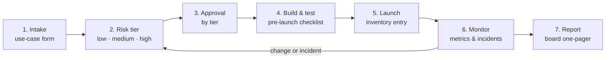

# AI Governance Playbook for Indian Enterprises

**A practical, template-first guide for taking GenAI and AI agents from idea to production, safely, under Indian law.**

Most AI governance documents describe principles. This one gives a team the forms, checklists and reports it can use on Monday morning. It is written for the people who have to make AI work in a real company: the Chief AI Officer, the Head of AI, the risk and compliance lead, and the product owner.

> This is practical guidance, not legal advice. Laws and regulator guidance change. Check the current text of the DPDP Act, the DPDP Rules and your sector regulator's directions with your legal team before relying on any of this.

---

## The lifecycle

## What is in it

| Step | Template | Use it to |
|---|---|---|
| 1 | [Use-case intake](templates/01-use-case-intake.md) | Capture what the AI will do, for whom, with which data |
| 2 | [Risk tiering](templates/02-risk-tiering.md) | Decide how much scrutiny a use case needs |
| 3 | [Approval matrix](templates/03-approval-matrix.md) | Know who signs off at each tier |
| 4 | [Pre-launch checklist](templates/04-pre-launch-checklist.md) | Test quality, safety, security and privacy before go-live |
| 4 | [DPDP checklist for AI](templates/05-dpdp-for-ai.md) | Map consent, purpose, erasure and breach duties to AI systems |
| 4 | [Vendor and model due diligence](templates/06-vendor-due-diligence.md) | Ask an LLM or AI vendor the right questions |
| 5 | [AI inventory](templates/07-ai-inventory.csv) | Keep one register of every AI system in production |
| 6 | [Incident response](templates/08-incident-response.md) | Handle a harmful output, a data leak or a misbehaving agent |
| 7 | [Board report](templates/09-board-report.md) | Report AI value and risk on one page |

## Principles behind the templates

1. **Scrutiny follows risk.** An internal summariser and an agent that moves money do not need the same process. Tiering keeps low-risk work fast.
2. **Evidence over assertions.** Every gate asks for a test result, a log or a named owner, not a "yes".
3. **Agents are different.** A system that takes actions needs limits, approvals and an undo path, not only good answers.
4. **India is multilingual.** Safety and quality must be tested in the languages users actually use, not only in English.
5. **Personal data is borrowed, not owned.** Purpose, consent and erasure must work across every place AI copies data: vector stores, caches, logs and agent memory.

## Open-source tools that fit this playbook

These are small tools I built that cover specific checks in the pre-launch checklist:

- [Kavach-Eval](https://github.com/Malaya-kumar-swain/kavach-eval): prompt-injection and data-leak testing in Indian languages
- [Agent-Pariksha](https://github.com/Malaya-kumar-swain/agent-pariksha): how an agent behaves when its tools fail
- [Vismriti](https://github.com/Malaya-kumar-swain/vismriti): consent, purpose-bound retrieval and erasure for RAG and agents

## Contributing

Corrections and sector-specific additions (banking, insurance, health, telecom, public sector) are welcome. Please open an issue first.

## Licence

[CC BY 4.0](https://creativecommons.org/licenses/by/4.0/). Use and adapt freely with credit. Written by [Malaya Kumar Swain](https://github.com/Malaya-kumar-swain). Views are my own and do not represent any employer.
